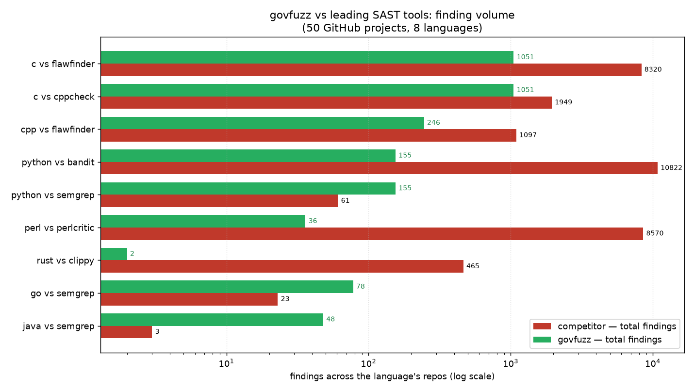
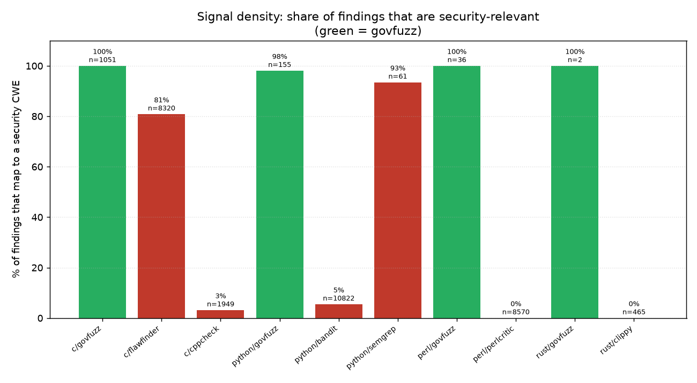

<!-- SPDX-License-Identifier: Apache-2.0 -->
# bhf vs leading SAST tools: a 50-project measurement

*bhf's static scanner (`bhf static-scan`) compared with the standard open-source SAST tool for each language, on 50 GitHub projects across the eight languages the campaign covered. The static rule matrix today also includes JavaScript/TypeScript and selected config and IaC checks, and bhf fuzzes sixteen languages.*

## Summary

We cloned 50 well-known open-source projects (Ada, C, C++, Rust, Go, Java, Python, Perl) and ran bhf's static scanner beside the leading open-source SAST tool or tools for each language. The results:

- **Security classes.** bhf reported the security-relevant classes the other tools reported: command injection, path traversal, unsafe deserialization, SSRF, disabled TLS, weak crypto, hardcoded secrets, and buffer, format and integer bugs. In Go and Java it reported more security findings than `semgrep`'s language packs, because its taint engine follows data across function boundaries.
- **Volume.** On the same code, `flawfinder` reported 8320 findings in C where bhf reported 1051; `bandit` 10822 in Python where bhf reported 155; `perlcritic` 8570 in Perl where bhf reported 36.
- **Output.** Every bhf finding carries a CWE, a severity and a confidence, and the taint classes carry a cross-function data-flow trace. Under `bhf auto --static`, a static finding at the site of a fuzz finding is upgraded to `fuzz_confirmed`; no other tool in the study has that step.





## Scale and performance on 10M+ SLOC

- **The Linux kernel, 37.2M SLOC of C, scans in 40 seconds** on a 6-core machine, at about 924,000 SLOC/s and 648 MB RSS. RocksDB (0.9M SLOC) scans in 2.4 s and Postgres (0.8M) in 2.8 s. Across the 49 scanned projects the scanner did not crash or hang, and its memory stayed bounded.
- The interprocedural taint pass extracts the call names from each source line and looks them up in the whole-project index, which costs O(tokens · log N).
- Scanning runs in parallel on a worker pool of `cores − 1` (`--jobs` sets it), and each file's source is dropped right after parsing, so steady-state memory grows with workers × file size, not with total SLOC. The output is byte-identical whatever the thread count.
- A memory watchdog samples RSS against a ceiling: by default the smaller of 80% of available host memory and 70% of a cgroup limit, or `--max-memory-mb`. At the ceiling, workers stop taking new files and the report records a truncation gap instead of the process being OOM-killed. A per-file size cap skips a generated or minified blob before reading it, and dependency and build trees (virtualenvs, `node_modules`, `dist`, vendored dependencies, generated JS `compiled/` bundles) are pruned before analysis.

## Method

| | |
|---|---|
| Projects | 50 repositories cloned shallowly from GitHub, from small single-file libraries to large trees (libarchive, mitmproxy, gnatcoll-core, alire). 49 were scanned; one Ada repository failed to clone. |
| bhf | `bhf static-scan <repo> --debug` (the campaign build of this repository). |
| Python | `bandit` 1.9.3; `semgrep` 1.168 (`p/python`). |
| Go | `gosec` 2.19; `semgrep` (`p/golang`). |
| Java | `semgrep` (`p/java`). SpotBugs and Find-Sec-Bugs need compiled bytecode, so this source-only run left them out. |
| C / C++ | `flawfinder` 2.0.19; `cppcheck` 2.13; `semgrep` (`p/c`). |
| Rust | `cargo clippy`. |
| Perl | `perlcritic` (Perl::Critic). |
| Ada | No readily installable open-source SAST tool (GNATcheck and CodePeer are GPL or commercial), so bhf's Ada results have no comparison. |

"Security-relevant" means the finding maps to a CWE in the injection, memory, crypto, secret, SSRF, TLS, path or randomness families a security reviewer triages, as opposed to a style or generic-correctness lint. Each tool's own CWE mapping is used where it has one.

Every finding count below can be reproduced; the harness and per-repository raw outputs are described under [Reproduction](#reproduction).

## Volume and signal, per language

| Language | Tool | Repos | Total findings | Security-CWE | Signal |
|---|---|--:|--:|--:|--:|
| C | **bhf** | 10 | **1051** | 1051 | **100%** |
| C | flawfinder | 10 | 8320 | 6724 | 81% |
| C | cppcheck | 9 | 1949 | 61 | 3% |
| C | semgrep `p/c` | 10 | 1 | 0 | — |
| C++ | **bhf** | 7 | **246** | 246 | **100%** |
| C++ | flawfinder | 7 | 1097 | 955 | 87% |
| C++ | cppcheck | 7 | 244 | 1 | 0% |
| Ada | **bhf** | 2 | 291 | 277 | 95% |
| Ada | *(no OSS SAST)* | — | — | — | — |
| Rust | **bhf** | 1 | 2 | 2 | 100% |
| Rust | clippy | 6 | 465 | 0 | 0% |
| Go | **bhf** | 6 | **78** | 78 | **100%** |
| Go | semgrep `p/golang` | 6 | 23 | 20 | 87% |
| Go | gosec | 1† | 11 | 10 | 91% |
| Java | **bhf** | 6 | **48** | 48 | **100%** |
| Java | semgrep `p/java` | 6 | 3 | 3 | 100% |
| Python | **bhf** | 7 | **155** | 152 | **98%** |
| Python | bandit | 8 | 10822 | 589 | 5% |
| Python | semgrep `p/python` | 8 | 61 | 57 | 93% |
| Perl | **bhf** | 4 | **36** | 36 | **100%** |
| Perl | perlcritic | 4 | 8570 | 0 | 0% |

† gosec resolves types through `go/packages`, which needs the module to build with the installed Go toolchain. Most modern repositories in the set require Go 1.23 or later (1.22 was installed), so gosec returned 0 findings on them; the table shows the one repository it fully analyzed (cobra). semgrep is AST-only and needs no build, so it carries the Go comparison.

`perlcritic` (style) and `clippy` (correctness and idiom) are linters, not security tools: they reported 8570 and 465 findings with no security-CWE content. Neither Perl nor Rust has a widely installed security scanner; bhf's Perl and Rust rules report security findings. Run clippy beside bhf for Rust lints: `bhf static-scan --external-tools` folds in gosec, Bandit, semgrep and GNATcheck, and does not run clippy or cppcheck.

## Does bhf find what the others find?

Mapping every tool's findings to CWE classes, per language, bhf covers the security classes the other tools report, and adds interprocedural taint classes that single-pattern rules do not see:

- **Command injection (CWE-78), path traversal (CWE-22), unsafe deserialization (CWE-502), SQL injection (CWE-89), log injection (CWE-117):** bhf's taint engine reports these as cross-function flows. In Go and Java it reported more instances (path traversal, disabled TLS, `ObjectInputStream` deserialization, secret exposure) than semgrep's packs, which match single-line patterns.
- **Buffer, format, integer and uninitialized bugs (CWE-120/787/134/190/457/197):** bhf overlaps with flawfinder and cppcheck here. flawfinder reports about 8× more because it flags every call to a banned function (`memcpy`, `strncpy`, `strcpy`, `sprintf`) whether or not the source is bounded. bhf grades by source (a string-literal `strcpy` is low, a variable-source `strcpy` medium, `gets` high) and reports a def-use-tracked uninitialized read rather than a blanket pattern.
- **Weak crypto (CWE-327), hardcoded secrets (CWE-798), disabled TLS (CWE-295), SSRF (CWE-918):** covered in the languages where they apply.

Two classes the other tools reported were added to bhf during this campaign:

- **Insecure randomness (CWE-338, rule `BHF-428`):** a non-cryptographic PRNG feeding a secret. bandit (`B311`), gosec (`G404`), semgrep and flawfinder all flag weak randomness. bhf's rule fires only when the value is a `token`, `key`, `nonce`, `salt`, `session`, `csrf`, `otp` or `credential`, so it reports that security-relevant subset rather than every `random()` used for jitter or test data, and it skips CSPRNG sources.
- **Weak crypto in C/C++ (CWE-327):** `MD5`, `SHA1`, `MD4`, `DES`, `RC4` and `crypt`. The interpreted-language rule was extended to C/C++.

[The coverage matrix](static-cwe-coverage.md) lists the classes bhf's static rules do not cover. XSS, CSRF and session-lifetime issues need a live framework or DOM and belong to DAST. cppcheck's null-dereference and generic-correctness findings belong to a bug-finding tool rather than a security scanner; run cppcheck or clippy alongside bhf for them.

## Why the volume gap is this large

Low-signal rules make up most of the other tools' totals:

- **bandit:** 9882 of its 10822 Python findings (91%) are `B101 assert_used` ("don't use `assert` in production"). Another large share is `B404`/`B603` ("you imported or called `subprocess`"). These are informational. bandit's security-relevant output is about 589 findings; bhf's 155 are the higher-severity, taint-traced subset, with less duplication.
- **flawfinder:** flags every occurrence of a dangerous function name. On zlib alone it reports 296 findings, mostly bounded `memcpy`/`strncpy` calls; bhf reports 130, graded by source.
- **perlcritic and clippy:** style and idiom linters; none of their output is a security finding.

bhf's lower count comes from three choices: it grades by danger (source-controlled versus literal), it follows flows across function boundaries (so a tainted flow is one finding with a trace, not a scatter of pattern hits), and it reports no finding for a construct that is only present (an import, a `with` clause, a banned function on a constant argument).

## Output attributes

| Attribute | bhf | flawfinder | bandit | semgrep | cppcheck | gosec | perlcritic | clippy |
|---|:-:|:-:|:-:|:-:|:-:|:-:|:-:|:-:|
| CWE on every finding | yes | yes | yes | partial | partial | yes | no | no |
| Severity and confidence | yes | level | severity | severity | severity | yes | severity | level |
| Cross-function data-flow trace | yes | no | no | Pro only | no | no | no | no |
| Remediation guidance | yes | yes | yes | yes | partial | yes | yes | yes |
| SARIF / baseline diff | yes | yes | yes | yes | yes | yes | no | yes |
| Fuzz confirmation | yes | no | no | no | no | no | no | no |

When `bhf auto --static` runs, bhf matches each static finding's file and line against the sink site of every runtime finding (a fuzz crash or an oracle hit). A static finding at the same site is upgraded to `fuzz_confirmed`, with high confidence and the ids of the runtime findings that confirmed it, so it comes with an input that reaches the flagged line. A static finding inside a function whose fuzzing marked its input reachability `reachability_unproven` or `output_serializer` is demoted to `lab_only`. A static finding the fuzzer did not reach stays `static`.

## Scanner bugs this measurement found

Running against 50 uncurated trees also tested the scanner. The campaign found and fixed a series of bhf false-positive sources, each with a regression case added to the precision benchmark:

- `for (i = 0; …)` loop variables and `&out` parameters reported as uninitialized reads (BHF-424);
- `fgets`/`archive_strcpy` matched as `gets`/`strcpy` for want of a word boundary (BHF-401); literal paths and function definitions matched as file-open sinks (BHF-405);
- Ada `with`/`use` imports and `Selected`/`Selection` matched as hazards (BHF-409/410/411/412);
- Perl POD documentation and heredoc prose analyzed as code; `clap::Command` matched as a shell spawn; Python doctests and keyword-argument defaults matched as hardcoded secrets;
- crypto-library primitives (`encrypt`, `mg_random`, a `CMD5` macro) matched as weak crypto or PRNG for want of a word boundary.

On the 50-repository corpus these fixes took the total from 3511 to 1907 findings (46% fewer), all of them false positives removed, while the precision benchmark's 0.90 floor and full-recall gate held. The scanner did not crash or hang on any of the 49 trees.

## Measurement scope

- **gosec** needs a buildable module, and the installed Go toolchain (1.22) was older than several repositories require, so its Go numbers are partial; semgrep carries the Go comparison.
- **Java** is compared with semgrep only; SpotBugs and Find-Sec-Bugs need compiled bytecode, which this source-only sweep did not build.
- **Rust:** bhf keeps a small Rust rule set, and clippy covers most Rust lints. The 2-versus-465 count reflects that split.
- **Ada** has no open-source SAST tool to compare with; bhf's Ada numbers stand alone.
- This measurement compares finding classes and volume. Labeled ground-truth precision and recall per site is what the curated [precision benchmark](../../benchmarks/static/README.md) measures: bhf holds precision of at least 0.90 at full recall on its curated set.

## Reproduction

The scan is one command per tool per repository. bhf's is:

```sh
bhf static-scan <repo> --out out --sarif
```

Every bhf rule in the tables has a labeled case in `benchmarks/static/corpus/`, and the precision benchmark (`cargo test -p static_analysis --test precision_benchmark`) fails when a rule drops below the floor. The other tools ran with their standard defaults, and the same category normalization was applied to every tool: `bandit -r`, `semgrep --config p/<lang>`, `flawfinder --csv`, `cppcheck --enable=warning,portability`, `gosec ./...`, `perlcritic --severity 3` and `cargo clippy`.
